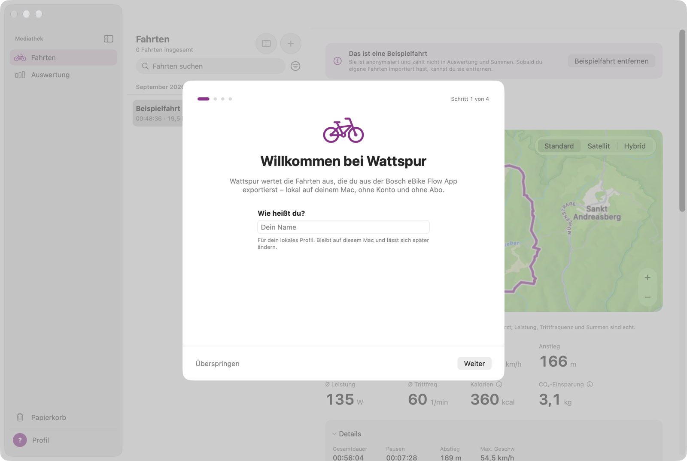
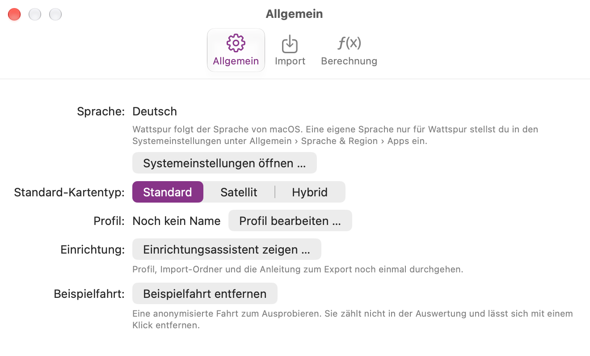

# Erster Start

Beim ersten Start öffnet sich ein kurzer Einrichtungsassistent. Jeden Schritt kannst du überspringen und später in den **Einstellungen** (⌘,) ändern.

1. **Dein Name.** Er ist für dein lokales Profil und bleibt auf diesem Mac.
2. **Dein erstes Bike.** Gib deinem eBike einen Namen und eine Farbe. Darunter deine Körperdaten (Gewicht, Größe, Geburtsjahr, Geschlecht) für eine Kalorienschätzung, die in einer späteren Version kommt; du kannst sie überspringen und später im [Profil](07-profile-and-bikes.md) nachtragen.
3. **Import-Ordner.** Wähle, wo neue Fahrten ankommen:
   - **iCloud Drive › Wattspur Import (empfohlen).** Wattspur lässt dich iCloud Drive einmal bestätigen und legt den Ordner an. Am iPhone sicherst du Exporte aus der Flow-App direkt dorthin.
   - **Anderen Ordner wählen …**, zum Beispiel einen Ordner auf diesem Mac oder in einem anderen Cloud-Dienst.
   - **Keinen Ordner.** Du ziehst Dateien selbst ins Fenster.
4. **So exportierst du aus der Flow-App.** Eine kurze Anleitung, ausführlich unter [Fahrten importieren](03-importing.md).
5. **Alles bereit.** Eine Zusammenfassung deiner Wahl und die Option **Beispielfahrt laden**.

## Die Beispielfahrt
Die Beispielfahrt ist eine echte Fahrt, die anonymisiert wurde, damit du Wattspur ausprobieren kannst, bevor du eigene Fahrten hast:
- Die Route ist an einen anderen Ort verschoben, und am Anfang und Ende fehlen je 500 m.
- Das Datum ist verschoben, die Seriennummer entfernt.
- Leistung, Trittfrequenz, Tempo und alle Summen sind unverändert.

In der Liste trägt die Beispielfahrt das Badge **Beispiel**. Sie zählt nicht in den Summen, der Auswertung und deinem Profil. Entfernen kannst du sie mit **Beispielfahrt entfernen** über ihren Details oder unter **Einstellungen › Allgemein**. Dort lässt sie sich auch wieder laden.

Den Assistenten noch einmal zeigen: **Einstellungen › Allgemein › Einrichtungsassistent zeigen …**

---
Weiter: [Fahrten importieren](03-importing.md)
