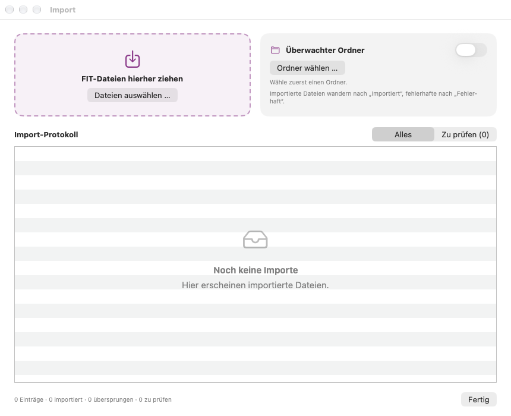

# Fahrten importieren

Wattspur liest **FIT-Dateien** aus der Bosch eBike Flow App. FIT enthält Leistung, Trittfrequenz und alle Summen. **GPX-Dateien** von anderen Bikes, Apps und Radcomputern werden ebenfalls importiert, siehe [GPX-Dateien importieren](08-importing-gpx.md).

## 1. Fahrt aus der Flow-App exportieren (iPhone)
1. Die **eBike Flow** App öffnen und unten auf **Statistiken** tippen.
2. Die Fahrt wählen.
3. Oben rechts das Menü öffnen und **FIT herunterladen** wählen.
4. Im nächsten Menü **In Dateien sichern** wählen.
5. **iCloud Drive › Wattspur Import** wählen und auf **Sichern** tippen.

Das machst du einmal pro Fahrt. Beim nächsten Blick in Wattspur auf dem Mac ist die Fahrt da.

> Die Namen der Menüpunkte können sich je nach Version der Flow-App leicht unterscheiden. Dieses Handbuch enthält bewusst keine Screenshots der Flow-App.

## 2. Überwachter Ordner (automatisch)
Hast du im Einrichtungsassistenten einen Ordner gewählt, beobachtet Wattspur ihn, solange die App geöffnet ist, und schaut bei jedem Start hinein:
- Neue FIT- und GPX-Dateien werden importiert und danach in den Unterordner **Importiert** verschoben.
- Dateien, die sich nicht lesen lassen, wandern nach **Fehlerhaft**. Das Import-Protokoll sagt, warum.
- Duplikate werden übersprungen und ebenfalls nach **Importiert** verschoben.
- iCloud-Dateien, die noch nicht geladen sind, werden angefordert und beim nächsten Durchlauf importiert.

Ordner ändern oder die Überwachung ausschalten: **Einstellungen › Import** oder im Import-Fenster.

## 3. Hineinziehen oder öffnen
- Eine oder mehrere FIT- oder GPX-Dateien auf die Fahrtenliste oder auf die Ablagefläche im Import-Fenster ziehen.
- Oder über der Liste auf **+** klicken (⌘O) und Dateien wählen.

Ist eine Fahrt schon in deiner Bibliothek, fragt Wattspur, ob du sie **überspringen** oder **aus neuen Dateien aktualisieren** willst. Beim Aktualisieren bleibt der Name, den du der Fahrt gegeben hast. Bei GPX-Dateien fragt Wattspur unter Umständen mehr, etwa für welches Bike eine GPX-Datei gilt oder wie mit derselben Fahrt als FIT und GPX umzugehen ist: siehe [GPX-Dateien importieren](08-importing-gpx.md).

## Import-Fenster und Protokoll
Zu öffnen mit dem Listen-Knopf neben **+** oder über **Ablage › Import-Protokoll** (⌥⌘L).

- Oben: die Ablagefläche und die Karte für den überwachten Ordner.
- Darunter: jeder Import mit seinem Ergebnis. **Zu prüfen** zeigt nur die Dateien mit Problemen, mit einer Begründung in Klartext und **Im Finder zeigen**. Gehört eine Fahrt wohl mit einer anderen vom selben Tag zusammen, steht das im Eintrag, mit dem Knopf **Zusammenfügen** (siehe [Ansichten](04-views.md)).
- Einträge, die älter als 90 Tage sind, werden automatisch entfernt.

Wattspur kopiert die Originaldateien in seine Bibliothek. Liest eine spätere Version von Wattspur Dateien besser, werden deine Fahrten automatisch aus diesen Kopien aktualisiert. Deine Namen und der Papierkorb bleiben dabei, wie sie sind.

---
Weiter: [Ansichten](04-views.md)
