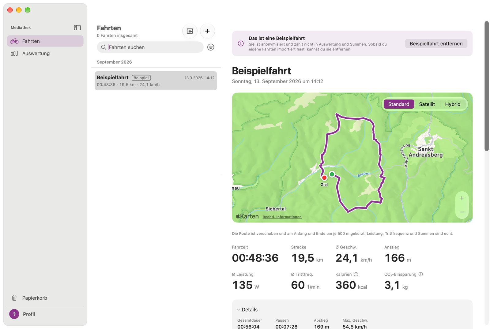

# Ansichten

Das Fenster hat drei Teile: links die Seitenleiste, in der Mitte die Fahrtenliste, rechts die Details. Ziehst du die Seitenleiste schmaler, zeigt sie nur noch Symbole. Alternativ benutzt du den Knopf oben in der Seitenleiste (⌃⌘S).

## Fahrten
- **Dein Jahr** über der Liste zeigt Kilometer und Fahrten des laufenden Jahres mit einem kleinen Balken je Monat. Ein Klick öffnet den Jahresrückblick in den [Highlights](#highlights). Diese Kachel folgt dem Bike- und Quellenfilter der Liste.
- Die Fahrten sind nach Monaten gruppiert, die neueste zuerst. Jede Zeile zeigt links die Route als kleine Linie (grüner Punkt = Start, ein Strich je Teil einer zusammengefügten Fahrt), dazu Name, Datum, Fahrzeit, Strecke und Ø Geschwindigkeit. ★ markiert eine Fahrt, die einen Rekord hält. Ein kleines **GPX** kennzeichnet eine Fahrt aus einer GPX-Datei, **+GPX** eine Bosch-Fahrt mit angehängter GPX; eine Bosch-FIT allein hat kein Symbol.
- **Suchen** nach Namen im Feld über der Liste.
- **Sortieren und filtern** mit dem Knopf neben dem Suchfeld: sortieren nach Datum, Strecke, Fahrzeit, Anstieg oder Ø Leistung. Anzeigen lassen sich diese Woche, dieser Monat, dieses Jahr, die letzten 30 oder 365 Tage oder alle Fahrten. Ab zwei Bikes lässt sich auch ein Bike zeigen, und sobald du eine GPX-Fahrt hast, eine Quelle: alle Quellen, Bosch-FIT (auch mit angehängter GPX) oder GPX.
- **Umbenennen** per Rechtsklick › Umbenennen ….
- **Ähnliche Fahrten zeigen** (Rechtsklick) filtert die Liste auf die Fahrten, die auf derselben Strecke liegen, siehe [Ähnliche Fahrten](#ähnliche-fahrten).
- **Als GPX exportieren …** (Rechtsklick) sichert die Route einer Fahrt, siehe [Tour-Detail](#tour-detail).
- **Löschen** mit der Rückschritt-Taste oder per Rechtsklick › In den Papierkorb. Das gilt für alle markierten Fahrten; bei mehr als einer fragt Wattspur vorher nach. ⌘Z holt sie zurück.
- **Fahrten zusammenfügen**, die zusammengehören, z. B. eine Fahrt, die wegen einer Kaffeepause in zwei Teilen aufgezeichnet wurde: markieren, dann Rechtsklick › … Fahrten zusammenfügen … oder **Zusammenfügen …** neben der Auswahl. Fahrten, die sich zeitlich überschneiden, lassen sich nicht zusammenfügen. Eine Lücke am selben Tag zählt als Pause, über mehrere Tage zählen nur die Fahrzeiten. Die neue Fahrt trägt in der Liste „2 Teile“; **Trennen** über den Details holt die Originalfahrten zurück.
- **Zusammenfügen vorgeschlagen:** Nach einem Import weist ein Hinweis über der Liste darauf hin, wenn Fahrten desselben Tages wohl zusammengehören („2 Fahrten vom 15. Okt. gehören wohl zusammen“): **Zusammenfügen** öffnet den Dialog zum Zusammenfügen, **Nicht jetzt** blendet den Hinweis aus. Das Import-Protokoll zeigt dieselbe Zeile mit einem Knopf. Wattspur fügt nie von selbst zusammen. Unter **Einstellungen › Import › Zusammenfügen** legst du die längste Pause zwischen den Fahrten fest oder schaltest den Hinweis aus.
- **Mehrere Fahrten:** mit ⌘-Klick oder ⇧-Klick auswählen. Bis du das einmal gemacht hast, erinnert ein Tipp unter der Liste daran; ✕ blendet ihn aus. Wattspur zeigt ihre Gesamtstrecke und -zeit, und **Ausgewählte Fahrten auswerten** (⇧⌘A) öffnet die Auswertung für genau diese Fahrten.
- **Fahrten vergleichen:** 2 bis 4 Fahrten markieren und **Vergleichen** (⇧⌘C) klicken oder Rechtsklick › … Fahrten vergleichen. Mehr dazu unter [Fahrten vergleichen](#fahrten-vergleichen).

## Ähnliche Fahrten
Pendelstrecke oder Lieblingsrunde: Wattspur findet die Fahrten, die denselben Weg genommen haben.
- **Einstieg:** Rechtsklick auf eine Fahrt › **Ähnliche Fahrten zeigen** oder der Knopf **Ähnliche Fahrten** im Tour-Detail. Das geht nur bei Fahrten mit Route; die Beispielfahrt, Fahrten im Papierkorb und die Teile einer zusammengefügten Fahrt zählen nicht.
- **Die Liste** zeigt dann nur noch die Fahrten auf dieser Strecke, in jeder Zeile steht, wie ähnlich sie ist („97 %“). Die Fahrt, nach der du gefragt hast, steht oben und trägt ein Zielsymbol (Bezugsfahrt). ⇄ kennzeichnet eine Fahrt in Gegenrichtung.
- **Der Chip** über der Liste nennt die Bezugsfahrt und die Zahl der Treffer („12 von 15“, wenn der Bike-, Quellen- oder Zeitraumfilter oder die Suche welche ausblenden). Darin:
  - **Ähnlichkeit:** der Regler von 80 bis 99 %. Je höher, desto genauer muss eine Fahrt der Strecke folgen. Wo der Regler beginnt, stellst du unter **Einstellungen › Allgemein › Ähnliche Fahrten** ein (Standard 90 %).
  - **Beide Richtungen** nimmt Fahrten dazu, die dieselbe Strecke andersherum gefahren sind, zum Beispiel den Rückweg von der Arbeit.
  - **Ähnlichste** oder **Neueste** zuerst.
  - ✕ hebt den Filter auf. Der Filter bleibt, wenn du eine Fahrt öffnest oder die Seitenleiste wechselst.
- **Vergleichen und auswerten:** Markiere 2 bis 4 Treffer und klicke **Vergleichen** ([Fahrten vergleichen](#fahrten-vergleichen)), oder markiere beliebig viele und klicke **Ausgewählte Fahrten auswerten**.
- **Verlauf:** Solange der Filter an ist und keine Fahrt markiert ist, zeigt die rechte Seite, wie sich die Fahrten auf dieser Strecke entwickeln: Fahrzeit, Ø Geschwindigkeit, Ø Leistung oder Ø Trittfrequenz über die Zeit. Jede Fahrt ist ein Punkt, die Linie ist das Mittel der letzten fünf Fahrten. Die beste Fahrt trägt einen ★ (bei der Fahrzeit die kürzeste, sonst der höchste Wert), die letzte einen Ring. Darunter stehen Bestwert, letzte Fahrt (mit dem Unterschied zum Durchschnitt) und Durchschnitt. Fehlt der Wert bei manchen Fahrten, etwa die Leistung in GPX-Dateien, steht „9 von 12 Fahrten“ darunter. Ein Klick auf einen Punkt öffnet die Fahrt, **Zurück zum Verlauf** (⌘[) kommt zurück, und **Diese Fahrten auswerten** öffnet die Auswertung mit allen Fahrten der Strecke. Der Verlauf nimmt alle Treffer bei der gewählten Ähnlichkeit, unabhängig von den anderen Filtern der Liste.
- Wie Wattspur „ähnlich“ meint, steht unter [Kennzahlen](05-metrics.md#ähnliche-fahrten).

## Gespeicherte Strecken
Eine Strecke, die du immer wieder fährst, etwa der Weg zur Arbeit, kannst du unter einem Namen speichern. Dann ist sie einen Klick entfernt, und neue Fahrten auf ihr gehören von selbst dazu.
- **Vorschlag:** Haben mindestens drei Fahrten dieselbe Strecke in derselben Richtung genommen und gehören noch zu keiner gespeicherten Strecke, steht über der Liste ein Hinweis: „Wohl dieselbe Strecke: 12 Fahrten“ mit dem Namen einer davon. **Als Strecke speichern …** öffnet das Fenster, **Nicht jetzt** blendet den Hinweis für diese Fahrten aus (er kommt erst für neue Fahrten wieder). Der Hinweis erscheint in der normalen Liste, ohne Suche und ohne „Ähnlich wie“. Wattspur speichert nie von allein eine Strecke.
- **Strecke speichern** fragt nach dem Namen (zunächst der Name der Fahrt), der Ähnlichkeit und ob Fahrten in Gegenrichtung dazugehören, und zählt live mit, wie viele Fahrten auf der Strecke liegen. Du kannst auch am Chip speichern: **⋯ › Als Strecke speichern …**, solange „Ähnlich wie“ an ist.
- **Benutzen:** Das Filter-Menü neben dem Suchfeld listet die **Gespeicherten Strecken** nach Namen. Eine Strecke ist ein Filter der Liste wie „Ähnlich wie“, mit demselben Chip („Strecke: Pendeln (12)“) und rechts dem Verlauf ihrer Fahrten. Der Regler und **Beide Richtungen** ändern die Strecke selbst und bleiben erhalten; **Ähnlichste** oder **Neueste** ist nur eine Ansicht.
- **Menü ⋯ am Chip:** **Strecke umbenennen …**, **Strecke auflösen** (die Fahrten bleiben, ⌘Z holt die Strecke zurück) und die Liste der gespeicherten Strecken.
- **Welche Fahrten dazugehören**, wird aus der Ähnlichkeit zur Strecke berechnet und nie je Fahrt gespeichert. Eine neue Fahrt auf der Strecke gehört von selbst dazu; nach einem Import sagt ein Hinweis es dir („Eine neue Fahrt liegt auf deiner Strecke „Pendeln““, mit **Strecke zeigen**). Löschst du die Fahrt, aus der eine Strecke entstanden ist, bleibt die Strecke.
- **Im Tour-Detail** nennt die Zeile „Strecke: …“ unter dem Titel die Strecke der Fahrt; ein Klick listet ihre Fahrten. Der Knopf **Ähnliche Fahrten (12)** zeigt, wie viele andere Fahrten bei deiner Standard-Ähnlichkeit auf der Strecke dieser Fahrt liegen.

## Fahrten vergleichen
Der Vergleich zeigt 2 bis 4 Fahrten nebeneinander, rechts neben der Liste. Die in der Liste markierten Fahrten **sind** der Vergleich: Mit ⌘-Klick kommt eine weitere hinzu, ✕ über einer Spalte nimmt sie heraus, ↗ zeigt nur diese Fahrt. **Fertig** (Esc) führt zurück zur Auswahl.
- **Karte:** alle Routen auf einer Karte, jede in Farbe und Strichart ihrer Spalte, mit ihrer Form am Start. Oben rechts umschalten zwischen Standard, Satellit und Hybrid.
- **Diagramme:** Höhe, Geschwindigkeit, Trittfrequenz und Leistung aller Fahrten übereinander, über die Strecke. Jede Fahrt hat eigene Farbe, Strichart und Form; die Linien lassen sich also auch ohne Farbe unterscheiden. Über jedem Diagramm stehen die Bosch-Durchschnitte jeder Fahrt, bei der Höhe stattdessen Anstieg, Abstieg und die steilste Stelle.
- **Tabelle:** alle Werte aus dem Tour-Detail, dazu Werte, die unterschiedlich lange Fahrten vergleichbar machen: Kalorien, Anstieg und Arbeit pro km, der Rollanteil und die Ø Leistung über die gesamte Fahrzeit. Siehe [Kennzahlen](05-metrics.md#fahrten-vergleichen).
- **Bester Wert:** ★ und eine getönte Zelle markieren den besten Wert einer Zeile, aber nur, wo mehr oder weniger eindeutig besser ist: Ø Geschwindigkeit, Ø Leistung und Ø Leistung über die Fahrzeit (mehr ist besser) sowie Pausen (weniger ist besser). Alle anderen Zeilen sind neutral.
- **Abweichung vom Schnitt:** Der Schalter oben zeigt unter jedem Wert den Unterschied zu deiner durchschnittlichen Fahrt, etwa „+2,1 km/h · +9 %“, und eine Spalte mit dem Schnitt.
- **PDF exportieren** oben links (⇧⌘E) öffnet den Vergleich als PDF in Vorschau, fertig zum Drucken oder Teilen; der Pfeil daneben bietet **Als PDF sichern …**. Das PDF hat A4-Format: Karte mit allen Routen und Diagramme auf der ersten Seite, danach die Tabelle, so wie sie gerade angezeigt wird (mit oder ohne Abweichung vom Schnitt).
- Die Beispielfahrt lässt sich vergleichen, zählt aber nie zum Schnitt. Eine zusammengefügte Fahrt ist eine Fahrt.

## Tour-Detail
- **Karte** mit Route, Start (grün) und Ziel (rot). Oben rechts umschalten zwischen Standard, Satellit und Hybrid. Die Voreinstellung legst du in den Einstellungen fest.
- **Kennzahlen:** Fahrzeit, Strecke, Ø Geschwindigkeit, Anstieg, Ø Leistung, Ø Trittfrequenz, Kalorien und CO₂-Einsparung. Werte mit ⓘ sind Schätzungen, siehe [Kennzahlen](05-metrics.md). Bei einer Fahrt aus einer GPX-Datei kennzeichnet ein kleines ≈ Fahrzeit, Strecke, Ø Geschwindigkeit und Anstieg (aus dem Track berechnet, siehe [GPX-Dateien importieren](08-importing-gpx.md)), und was die Datei nicht enthält, steht als „–“ mit „Nicht in der Datei“.
- **Neue Wege:** wie viel der Fahrt auf Wegen lag, die du vorher noch nie gefahren bist, etwa „23 % · 4,5 km“. Auf der Karte sind diese Stücke breiter und orange. Siehe [Kennzahlen](05-metrics.md#karte).
- **Strecke:** Liegt die Fahrt auf einer gespeicherten Strecke, nennt die Zeile unter dem Titel sie; ein Klick listet die Fahrten darauf, siehe [Gespeicherte Strecken](#gespeicherte-strecken).
- **Zurück zur Karte**, **Zurück zur Auswertung** bzw. **Zurück zu Highlights** (⌘[) steht oben, wenn du die Fahrt von dort geöffnet hast; aus den Highlights auch über mehreren markierten Fahrten, zurück auf denselben Reiter und dasselbe Jahr.
- **Details** (zum Ein- und Ausklappen): Gesamtdauer, Pausen, Abstieg, Höchstgeschwindigkeit, maximale Leistung und Trittfrequenz, Arbeit und die Höhe min.–max.
- **Diagramme** für Höhe, Geschwindigkeit, Trittfrequenz und Leistung, jeweils mit Maximum und Durchschnitt. Der Umschalter darüber wählt, was unten entlangläuft: **Strecke** oder **Zeit** (Fahrzeit seit dem Start, als h:mm). Wattspur merkt sich die Auswahl. Auf der Zeitachse bleiben Pausen leer.
  - **Diagramme und Karte gekoppelt:** Fährst du mit dem Mauszeiger über ein Diagramm, erscheint in allen vier Diagrammen ein Strich mit dem Wert an dieser Stelle, und ein Punkt auf der Karte zeigt, wo das ist. Fährst du auf der Karte über die Route, folgen die Striche. Ein Klick hält die Stelle fest (Pin neben dem Wert); ein weiterer Klick oder Esc löst sie. Im PDF ist das nicht zu sehen.
  - **Fügestellen:** In einer zusammengefügten Fahrt zeigen ein feiner Strich in jedem Diagramm und ein kurzer schwarzer Querstrich über der Route auf der Karte, wo zwei Teile aneinanderstoßen (auch im PDF). Treffen sich die Teile nicht, bekommen beide Enden einen Querstrich; auf der Zeitachse wird eine Pause von zwei Linien eingerahmt.
- **Rekorde:** Hält die Fahrt einen Rekord, nennt ihn eine Zeile über den Kennzahlen mit dem nächstbesten Wert, und die Kennzahl bekommt das Abzeichen ★ Rekord. **Alle Rekorde** öffnet Highlights › Rekorde. Das Abzeichen bleibt nur, solange die Fahrt den Rekord hält.
- **PDF exportieren** oben links (⇧⌘E) öffnet die Fahrt als PDF in Vorschau: Karte, Kennzahlen und Details auf der ersten Seite, die Diagramme auf der zweiten. Der Pfeil daneben bietet **Als PDF sichern …**.
- **Als GPX exportieren …** daneben sichert die Route als GPX-Datei (GPX 1.1) für komoot, ein Navigationsgerät oder eine andere App: Position, Höhe und Zeit jeder Sekunde, dazu Leistung und Trittfrequenz in den Erweiterungen, die Garmin und Strava verwenden. Eine zusammengefügte Fahrt behält ein Segment je Teil, damit keine gerade Linie über die Lücke entsteht. Die Beispielfahrt exportiert ihre verschobene Route.

## Auswertung
In der Seitenleiste **Auswertung** wählen (⌘2). Links steht die Fahrtenliste, aber nur mit den Fahrten, die gerade ausgewertet werden.
- **In der Karte zeigen** neben der Überschrift zeigt genau diese Fahrten auf der [Karte](#karte).
- **Zeitraum** oben: Woche, Monat, Jahr, ein freier Zeitraum oder alle Fahrten. ⌘← und ⌘→ springen zum vorherigen und nächsten Zeitraum.
- **Summen:** Fahrten, Strecke, Fahrzeit, Anstieg, Arbeit, Kalorien, CO₂-Einsparung und Ø je Fahrt. Haben nur einige Fahrten einen Wert (zum Beispiel Leistung in GPX-Dateien), sagt das eine Zeile wie „9 von 12 Fahrten“. Unter jedem Wert steht die Veränderung zum Vorzeitraum, zum Beispiel „▲ +12 % ggü. September“.
- **Durchschnitte:** Geschwindigkeit, Leistung und Trittfrequenz, gewichtet nach Fahrzeit. Eine lange Fahrt zählt also mehr als eine kurze.
- **Balkendiagramm:** Strecke, Fahrzeit oder Anstieg je Tag, Woche, Monat oder Jahr. Einen Balken anklicken (oder das Diagramm mit Tab wählen und ← und → benutzen), um seine Werte zu sehen.
- **Trends:** Ø Leistung, Trittfrequenz und Geschwindigkeit jeder Fahrt, mit einer Linie für das Mittel der letzten fünf Fahrten.

## Highlights
In der Seitenleiste **Highlights** wählen (⌘4). Oben drei Reiter; jeder hat oben links **PDF exportieren** (⇧⌘E), das den Reiter als PDF in Vorschau öffnet oder sichert.
- **Jahr:** Strecke, Fahrten, Fahrzeit, Anstieg und CO₂-Einsparung eines Jahres, mit der Veränderung zum Vorjahr. Die Pfeile oben (⌘← und ⌘→) wechseln das Jahr. Darunter:
  - **Fahrtage:** ein Kalender mit einem Kästchen je Tag, von Montag bis Sonntag; je dunkler, desto mehr Kilometer (unter 10, 10–25, 25–50, ab 50 km). Mit dem Zeiger auf einem Tag steht seine Strecke da; ein Klick zeigt seine Fahrten in der Liste.
  - **Kilometer je Monat** als Balken; der beste Monat ist dunkler.
  - **Rekorde dieses Jahres.**
- **Rekorde:** deine Bestwerte über alle Fahrten: längste Fahrt, längste Fahrzeit, meiste Höhenmeter, höchste Ø Geschwindigkeit, höchste Ø Leistung, längste Serie an Fahrtagen sowie Höchstgeschwindigkeit, höchste Leistung, höchste Trittfrequenz und beste 1-Minuten-Leistung. Ein Klick auf eine Karte zeigt die Fahrt. „Neu“ markiert einen Rekord aus einer Fahrt, die in den letzten 7 Tagen importiert wurde. Siehe [Kennzahlen](05-metrics.md#highlights).
- **Ziele:** Kilometer, Fahrten oder Höhenmeter je Woche (Montag bis Sonntag), Monat oder Jahr. **Ziel hinzufügen …** legt eins an; je Zeitraum und Kennzahl gibt es höchstens ein Ziel. Jede Karte zeigt den Stand, was noch fehlt und ob du im Plan bist (mindestens so weit wie die verstrichene Zeit), dazu kleine Balken für die letzten Zeiträume. ✎ ändert oder löscht ein Ziel.
- **Neuer Rekord nach einem Import:** Schlägt eine importierte Fahrt einen deiner Rekorde, nennt ein Hinweis oben im Fenster den Rekord und den bisherigen Wert; **Fahrt zeigen** öffnet sie. Das gilt für jeden Import, auch aus dem überwachten Ordner. Auch das Import-Protokoll vermerkt ihn.
- Fahrten ohne Leistung oder Anstieg halten dafür keinen Rekord. Das Jahr zeigt „9 von 12 Fahrten“ unter dem Anstieg, wenn nicht jede Fahrt ihn hat; ein Anstiegsziel sagt es auch.
- Die Beispielfahrt zählt nie; eine zusammengefügte Fahrt ist eine Fahrt.

## Karte
In der Seitenleiste **Karte** wählen (⌘5): alle deine Fahrten auf einer Karte. Links steht die Fahrtenliste, aber nur mit den Fahrten im sichtbaren Kartenausschnitt; sie folgt dem Schieben und Zoomen. Eine dort markierte Fahrt erscheint blau auf der Karte, ein Doppelklick öffnet sie.
- **Zeitraum** oben wie in der Auswertung: Woche, Monat, Jahr, ein freier Zeitraum oder alle Fahrten.
- **Nur markierte Fahrten:** zeigt die in der Liste markierten Fahrten; 1 bis 4 davon in Farbe und Strichart des Vergleichs.
- **Linien | Wärmekarte** rechts neben dem Titel:
  - **Linien:** Jede Fahrt ist eine halbtransparente Linie. Wo du oft fährst, werden die Wege kräftiger und breiter. Die Legende zeigt, wie 1, 5, 20 und 60 Fahrten aussehen.
  - **Wärmekarte:** färbt kleine Flächen danach, wie viele verschiedene Fahrten dort durchkommen, in festen Stufen 1, 2–4, 5–9, 10–19 und 20+ von Blau nach Rot.
- **Klick auf eine Strecke** zeigt die Fahrten, die dort verlaufen, mit **Alle in der Liste markieren**. Ein Klick auf eine davon hebt sie hervor und zeigt ihre Kennzahlen mit **Im Tour-Detail öffnen**. Esc oder ein Klick neben alle Strecken schließt das Fenster; dieser Klick hebt auch die Markierung in der Liste auf, außer bei **Nur markierte Fahrten**.
- **Unter der Karte** stehen Fahrten, Strecke, Fahrzeit, Anstieg, Ø Geschwindigkeit und neue Wege der Fahrten im Ausschnitt. Es zählen ganze Fahrten mit ihren Summen, auch wenn nur ein Stück im Ausschnitt liegt. **In der Auswertung zeigen** wertet genau diese Fahrten aus.
- **Alle Fahrten zeigen** (Pfeile oben rechts) passt den Ausschnitt an alle Fahrten an; daneben der Kartentyp. Den Ausschnitt behält die Karte, wenn du in einen anderen Bereich und zurück wechselst.
- **PDF exportieren** (⇧⌘E) öffnet den sichtbaren Ausschnitt mit Kacheln und Legende als PDF.
- Fahrten ohne GPS (z. B. auf der Rolle) nennt die Zeile unter dem Titel. Die Beispielfahrt erscheint nur, wenn du sie markierst.
- Gibt es eine GPX-Fahrt in der Bibliothek, zeigt eine Auswahl **Quelle** neben dem Bike-Filter nur Bosch- oder nur GPX-Fahrten.
- Die Karte zeigt, wo du fährst und damit auch, wo du wohnst. Überlege, bevor du ein PDF davon teilst.

## Papierkorb
Gelöschte Fahrten bleiben 30 Tage im Papierkorb. **Wiederherstellen** holt eine Fahrt zurück in die Liste. **Papierkorb leeren …** löscht alle Fahrten darin endgültig, samt Originaldateien.

## Profil und Einstellungen
- **Profil** (unten in der Seitenleiste, ⌘6): dein Name, deine Körperdaten und deine Bikes, siehe [Profil und Bikes](07-profile-and-bikes.md).
- **Einstellungen** (⌘,):
  - **Allgemein:** Sprache (Wattspur folgt macOS), Standard-Kartentyp, Profil, Einrichtungsassistent, Beispielfahrt.
  - **Import:** überwachter Ordner, Ein- und Ausschalten, Status und Regeln, und wann Wattspur vorschlägt, Fahrten zusammenzufügen.
  - **Berechnung:** für spätere Versionen vorgesehen.

## Tastatur
| Tasten | Aktion |
|---|---|
| ⌘1, ⌘2, ⌘3 | Fahrten, Auswertung, Papierkorb |
| ⌘4, ⌘5, ⌘6 | Highlights, Karte, Profil |
| ⌘[ | Zurück zur Karte, Auswertung, zu Highlights oder zum Verlauf (im Tour-Detail) |
| ⌘← / ⌘→ | Vorheriges / nächstes Jahr in Highlights › Jahr |
| ⌘O | Fahrten importieren |
| ⌥⌘L | Import-Fenster und Protokoll |
| ⇧⌘C | Markierte Fahrten vergleichen (2 bis 4) |
| ⇧⌘E | Fahrt, Vergleich, Highlights-Reiter oder Karte als PDF in Vorschau öffnen |
| ⇧⌘A | Ausgewählte Fahrten auswerten |
| ⌘← / ⌘→ | Vorheriger / nächster Zeitraum in der Auswertung |
| ⌃⌘S | Seitenleiste verkleinern oder erweitern |
| Rückschritt, ⌘Z | In den Papierkorb, widerrufen |
| ⌘, | Einstellungen |
| ⌘? | Dieses Handbuch öffnen (Menü Hilfe) |

## Bedienungshilfen
- Jede Kennzahl und jeder Knopf hat eine VoiceOver-Beschriftung.
- VoiceOver kann jedes Diagramm als **Audiografik** abspielen: Auf einem Diagramm VO-Umschalt-A (⌃⌥⇧A) drücken und „Audiografik abspielen“ wählen, oder die Werte einzeln durchgehen. Hältst du eine Stelle in den Diagrammen und auf der Karte mit einem Klick fest, sagt VoiceOver sie mit ihren Werten an.
- Veränderungen zeigt Wattspur mit Pfeil und Vorzeichen, nie nur mit Farbe.

## Hilfe
- **Hilfe › Wattspur-Handbuch** (⌘?) öffnet dieses Handbuch online, in der Sprache der App. Dasselbe Menü öffnet die Kapitel **Fahrten importieren** und **Fragen und Fehlerbehebung** und die **Versionshinweise** auf GitHub. Die leere Fahrtenliste verweist auf die Export-Anleitung.
- **Ablage › Mediathek-Backup …** sichert deine ganze Mediathek (Fahrten, Bikes, Ziele, Notizen) als Ordner und stellt sie aus einem Ordner wieder her, siehe [Fragen](06-faq.md#wie-sichere-ich-meine-fahrten-oder-ziehe-auf-einen-neuen-mac-um).
- **Hilfe › Diagnose erstellen …** speichert eine Textdatei mit dem Import-Protokoll und den Versionen von Wattspur und macOS, auf Wunsch zusammen mit einer Datei, deren Import fehlgeschlagen ist. Es wird nichts gesendet; du entscheidest, wem du die Datei gibst.
- **Wattspur › Über Wattspur** zeigt Version, Build und Lizenz.

---
Weiter: [Kennzahlen](05-metrics.md)
