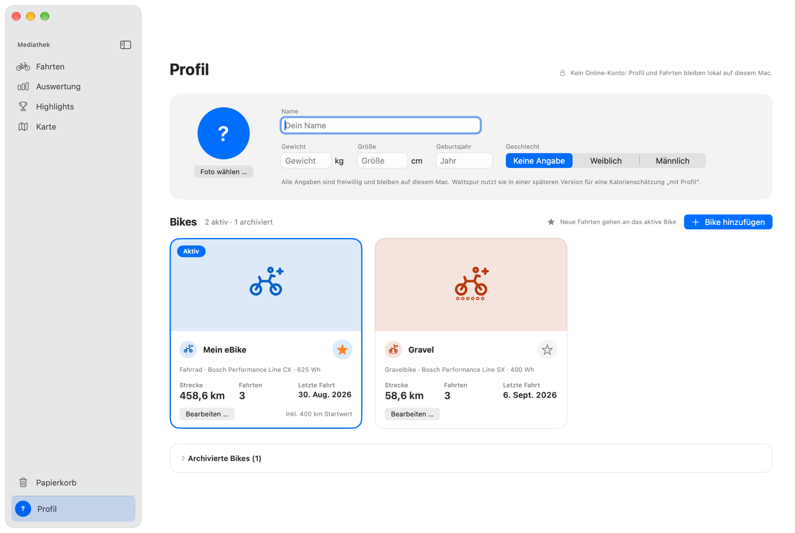

# Profil und Bikes

Wattspur führt ein **Profil** mit deinen Körperdaten und so viele **Bikes**, wie du hast. Jede Fahrt gehört zu einem Bike, so kannst du jedes Bike für sich ansehen. Alles bleibt auf deinem Mac.

## Das Profil
Wähle **Profil** unten in der Seitenleiste (⌘6).
- **Du:** Name, Foto (freiwillig) und Körperdaten: Gewicht, Größe, Geburtsjahr und Geschlecht. Alles ist freiwillig und bleibt auf deinem Mac. Es wird für eine Kalorienschätzung „mit Profil“ gespeichert, die in einer späteren Version kommt; vorerst ändert es keine Zahl. Zahlen, die nicht stimmen können (ein Gewicht von 7 kg), werden nicht gespeichert.
- **Fahrzeuge:** eine Kachel je Bike oder Fahrzeug mit Foto (oder farbigem Symbol), Name, Art, Antrieb und Akku, der Strecke (mit dem eingetragenen Startwert), der Zahl der Fahrten und der letzten Fahrt.
- **Hinweis auf den Radumfang:** Bosch misst Strecke und Tempo am Rad. Ist der Radumfang in der Flow-App falsch eingestellt, sind beide zu hoch oder zu niedrig. Wattspur vergleicht deshalb in den neuesten 20 Bosch-Fahrten eines Bikes die Strecke vom Radsensor mit der Strecke aus dem GPS, nur dort, wo das GPS gut war (ohne Lücken, nicht im Stand). Ab 2 % Unterschied über mindestens drei Fahrten und 20 km zeigt die Kachel einen Hinweis, zum Beispiel „Der Radsensor misst 3,7 % mehr als GPS“. Prüfe dann den Radumfang in der Flow-App. Wattspur ändert die Werte deiner Fahrten nicht. GPS ist auch nicht genau, darum erscheint der Hinweis erst ab 2 %.

## Bike anlegen und bearbeiten
**Fahrzeug hinzufügen** (ab Mac 1.9.1; vorher **Bike hinzufügen**) oder **Bearbeiten …** an einer Kachel öffnet den Editor:
- **Name, Farbe und Fahrzeugart:** Fahrrad, Mountainbike, Rennrad, Gravelbike, Lastenrad, Motorrad oder Auto, beim Rad dazu der Schalter **E-Bike**. Die Art bestimmt das Symbol, die Farbe färbt es überall, wo das Bike erscheint.
- **Motorrad und Auto:** Du kannst mehrere Fahrzeuge anlegen, zum Beispiel „Nugget“ und „Zweitwagen“. Fahrten mit einem Fahrzeug stehen in der Liste, auf der Karte und in seiner Kachel, zählen aber nicht in Summen, Auswertung, Highlights, Rekorden, Zielen und im Durchschnitt beim Vergleich und sparen kein CO₂. Stellst du den Bike-Filter auf das Fahrzeug, zeigen Auswertung und Highlights seine eigenen Zahlen, CO₂ weiterhin nicht. **Autos brauchen Wattspur ab Mac 1.9 und iPhone 1.1 auf allen deinen Geräten:** Ältere Versionen kennen das Auto nicht und zählen seine Fahrten als Radfahrten. Zum Aufnehmen am iPhone siehe [iPhone und iCloud](09-iphone-and-icloud.md#motorrad).
- **Foto:** nur hier und in der Kachel im Profil; sonst siehst du das farbige Symbol.
- **Hersteller, Modell, Antrieb, Akku (Wh), Gewicht, Kaufdatum** und **Kilometer-Startwert**; Antrieb und Akku nur beim Rad (der Kilometerstand vor deiner ersten Fahrt in Wattspur; er zählt nur in der Kachel). Das Gewicht ist zur Information und fließt in keine Rechnung ein.
- **Fahrzeug archivieren:** Ein Bike oder Fahrzeug, das du nicht mehr fährst, verschwindet aus dem Import-Menü, seine Fahrten bleiben aber zugeordnet, und es bleibt in den Filtern. Unter **Archivierte Fahrzeuge** am Ende des Profils steht es mit **Wiederherstellen** und, ab Mac 1.9.1, **Löschen …**: Löschen geht nur ohne Fahrten in der Liste (weise sie erst einem anderen Fahrzeug zu), damit keine Fahrt ihr Fahrzeug verliert. Fahrten im Papierkorb behalten dabei ihre Art, eine Autofahrt bleibt eine Autofahrt. Gelöscht verschwindet es über iCloud auch am iPhone. Das letzte Fahrzeug lässt sich nicht archivieren, weil neue Fahrten eins brauchen.

## Zu welchem Bike gehört eine neue Fahrt?
Bosch-Exporte enthalten keine Bike-Kennung, Wattspur kann deine Bikes deshalb nicht von allein unterscheiden. Neue Fahrten gehen an das **aktive Bike**, das mit dem Stern im Profil (und der Marke **Aktiv**). Ab zwei Bikes schaltet ein Menü **Import für ● Bike** über der Fahrtenliste um; es gilt für jeden Import, auch aus dem überwachten Ordner.

## Fahrten einem anderen Bike zuweisen
- **Rechtsklick auf eine Fahrt** (oder mehrere markierte) › **Fahrzeug zuweisen**, oder der Knopf **Fahrzeug zuweisen**, wenn mehrere Fahrten markiert sind.
- Im **Tour-Detail** hat das Bike neben dem Titel ein Menü.
- Eine Hinweiszeile am unteren Fensterrand sagt, was passiert ist; **Rückgängig** oder ⌘Z nimmt es zurück.
- Eine zusammengefügte Fahrt gehört zum Bike ihres ersten Teils und wandert mit ihren Teilen.

## Wo du das Bike siehst
- In der **Fahrtenliste** als Symbol am Ende der zweiten Zeile (ab zwei Bikes).
- Im **Vergleich** als Zeile **Fahrzeug**, auch im PDF.
- Im **PDF einer Fahrt**: „Fahrzeug: Name · Antrieb“.
- In einer exportierten **GPX-Datei** als Beschreibung der Strecke, sodass auch andere Programme es zeigen.

## Ein Bike für sich ansehen
**Fahrten**, **Auswertung**, **Karte** und **Highlights** haben je einen Filter nach Fahrzeug und merken sich ihre Wahl: **Fahrzeug: Alle Fahrzeuge ▾** neben dem Zeitraum (in der Fahrtenliste steckt er im Menü neben dem Suchfeld, bei Zeitraum und Sortierung). Archivierte Bikes stehen unter **Archiviert**. Ab Mac 1.10 bietet der Filter nur die Geräte der Sportart, die oben in der Seitenleiste gewählt ist (**Alle Bikes** oder **Alle Fahrzeuge**), siehe [Ansichten](04-views.md).
- In den **Highlights** folgen Jahr und Rekorde dem Filter. **Ziele zählen immer alle deine Bikes.**
- Fahrten, die du von Hand wählst und an die Auswertung oder die Karte schickst, werden unabhängig vom Bike gezeigt.
- Sobald du eine Fahrt aus einer GPX-Datei hast, hat jeder Bereich daneben auch einen Filter **Quelle**, siehe [GPX-Dateien importieren](08-importing-gpx.md#so-siehst-du-gpx-fahrten). Eine GPX-Datei sagt nicht, auf welchem Bike sie gefahren wurde: Wattspur fragt danach, siehe [GPX-Dateien importieren](08-importing-gpx.md#importieren).

Ab Mac 1.9.1 heißen Knöpfe, Menüs und Filter „Fahrzeug“ statt „Bike“, weil dort auch Autos und Motorräder stehen. Eine Fahrt mit **Fahrrad** ohne Gerät (am iPhone unter **Fahrzeugart**, z. B. ein geliehenes Rad) zählt in die Rad-Summen, aber zu keinem deiner Bikes; mit dem Filter **Alle Bikes** (bis Mac 1.9.1 **Alle Fahrzeuge**) ist sie dabei.

## Umstieg von einer früheren Version
Mit 1.5 wurden alle bisherigen Fahrten einem Bike namens **Mein eBike** zugeordnet. Ein Hinweis oben im Fenster bittet dich einmal, deine Bikes einzurichten: benenne es um und lege die anderen im Profil an. Neue Installationen fragen im [Einrichtungsassistenten](02-first-launch.md) nach dem ersten Bike.

---
Zurück: [Kennzahlen](05-metrics.md) · Weiter: [Fragen und Fehlerbehebung](06-faq.md)
