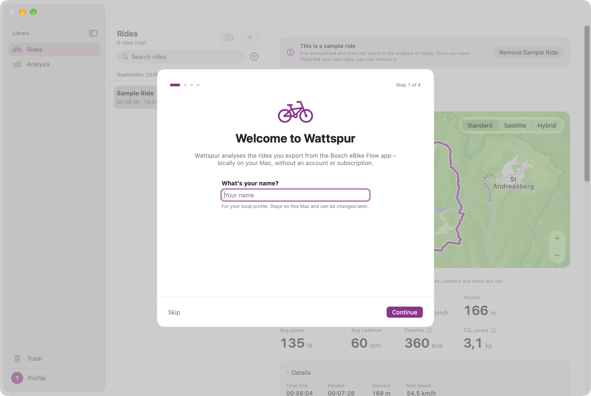
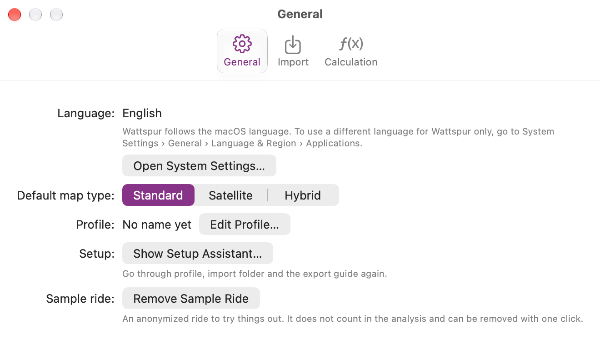

# First launch

On the first start a short setup assistant opens. Every step can be skipped and changed later in **Settings** (⌘,).

1. **Your name.** It is used for your local profile and stays on this Mac.
2. **Your first bike.** Give your eBike a name and a color. Below it, your body data (weight, height, year of birth, sex) for a calorie estimate that comes in a later version; you can skip them and add them later in the [profile](07-profile-and-bikes.md).
3. **Import folder.** Choose where new rides arrive:
   - **iCloud Drive › Wattspur Import (recommended).** Wattspur asks you to confirm iCloud Drive once and creates the folder. On your iPhone you save exports from the Flow app straight into it.
   - **Choose Another Folder…**, for example a folder on this Mac or in another cloud service.
   - **No folder.** You drag files onto the window yourself.
4. **How to export from the Flow app.** A short guide, explained in detail in [Importing rides](03-importing.md).
5. **All set.** A summary of your choices, and the option **Load a sample ride**.

## The sample ride
The sample ride is a real ride, made anonymous so you can try Wattspur out before you have your own rides:
- The route is moved to another place and 500 m are cut off at the start and at the end.
- The date is moved and the serial number is removed.
- Power, cadence, speed and all totals are unchanged.

The sample ride is marked **Sample** in the list. It does not count in the totals, the analysis or your profile. Remove it with **Remove Sample Ride** above its details, or in **Settings › General**, where you can also load it again.

To see the assistant again: **Settings › General › Show Setup Assistant…**

---
Next: [Importing rides](03-importing.md)
