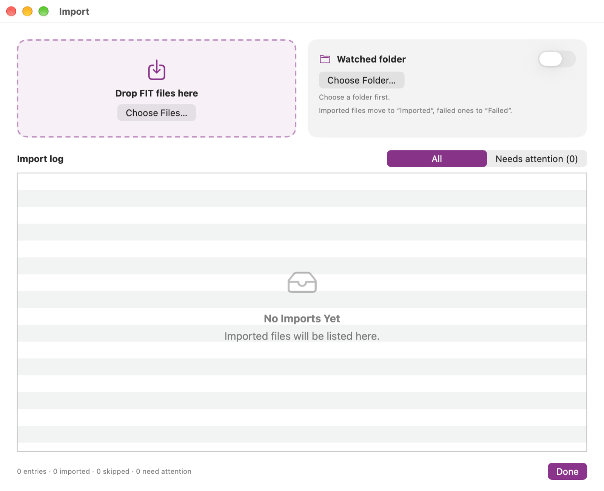

# Importing rides

Wattspur reads **FIT files** exported from the Bosch eBike Flow app. FIT contains the power, cadence and all totals. **GPX files** from other bikes, apps and bike computers are imported too; see [Importing GPX files](08-importing-gpx.md).

## 1. Export a ride from the Flow app (iPhone)
1. Open the **eBike Flow** app and tap **Statistics** at the bottom.
2. Pick the ride.
3. Tap the menu at the top right and choose **Download FIT**.
4. In the menu that opens next, choose **Save to Files**.
5. Choose **iCloud Drive › Wattspur Import** and tap **Save**.

Do this once per ride. The next time you look at Wattspur on your Mac, the ride is there.

> The names of the menu items may differ slightly between versions of the Flow app. This guide intentionally contains no screenshots of the Flow app.

## 2. Watched folder (automatic)
If you chose a folder in the setup assistant, Wattspur watches it while it is open and checks it every time it starts:
- New FIT and GPX files are imported and then moved to the subfolder **Imported**.
- Files that cannot be read move to **Failed**. The import log says why.
- Duplicates are skipped and also moved to **Imported**.
- iCloud files that are not downloaded yet are requested and imported on the next pass.

Change the folder or switch watching off in **Settings › Import**, or in the import window.

## 3. Drag and drop, or open
- Drag one or more FIT or GPX files onto the ride list or onto the drop area of the import window.
- Or click **+** above the list (⌘O) and choose files.

If a ride is already in your library, Wattspur asks whether to **skip** it or **update it from the new file**. Updating keeps the name you gave the ride. With GPX files Wattspur may ask more, for example which bike a GPX file belongs to, or how to treat the same ride as FIT and GPX: see [Importing GPX files](08-importing-gpx.md).

## Import window and log
Open it with the list button next to **+**, or with **File › Import Log** (⌥⌘L).

- At the top: the drop area and the card for the watched folder.
- Below: every import with its result. **Needs attention** shows only the files that failed, with a reason in plain words and **Show in Finder**. If the ride is likely to belong with another one from the same day, the entry says so and has a **Merge** button (see [Views](04-views.md)).
- Entries older than 90 days are removed automatically.

Wattspur copies the original files into its library. If a later version of Wattspur reads files better, your rides are updated from these copies automatically; your names and the trash stay as they are.

---
Next: [Views](04-views.md)
