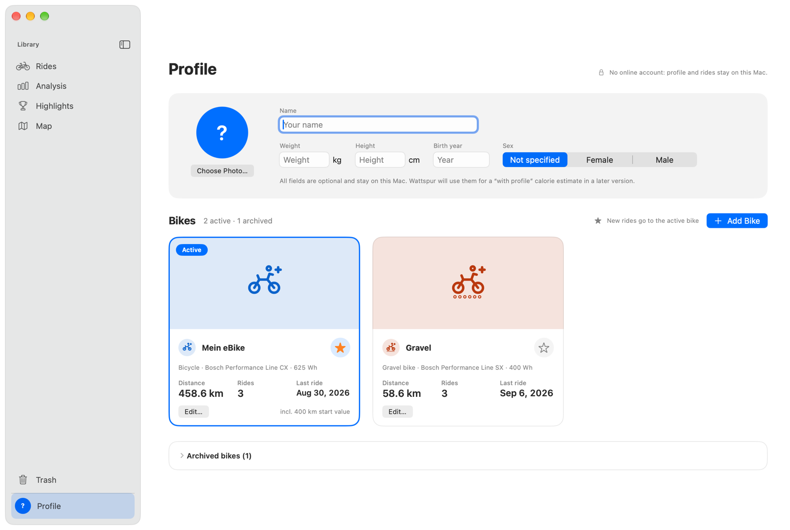

# Profile and bikes

Wattspur keeps one **profile** with your body data and as many **bikes** as you have. Every ride belongs to one bike, so you can look at each bike on its own. Everything stays on your Mac.

## The profile
Choose **Profile** at the bottom of the sidebar (⌘6).
- **You:** name, photo (optional), and body data: weight, height, year of birth and sex. All of it is optional and stays on your Mac. It is stored for a calorie estimate “with profile” that comes in a later version; for now it changes no number. Numbers that cannot be right (a weight of 7 kg) are not saved.
- **Bikes:** one tile per bike with its photo (or its coloured symbol), name, type, drive unit and battery, the distance (including the starting mileage you entered), the number of rides and the last ride.
- **Hint on the wheel circumference:** Bosch measures distance and speed at the wheel. If the wheel circumference in the Flow app is wrong, both are too high or too low. So Wattspur compares, over the newest 20 Bosch rides of a bike, the distance of the wheel sensor with the distance from GPS, only where GPS was good (no gaps, not standing). From a difference of 2 % over at least three rides and 20 km, the tile shows a hint such as “The wheel sensor measures 3.7 % more than GPS”. Then check the wheel circumference in the Flow app. Wattspur does not change the values of your rides. GPS is not exact either, which is why the hint only appears from 2 %.

## Adding and editing a bike
**Add Bike** (or **Edit…** on a tile) opens the editor:
- **Name, colour and type:** bicycle, mountain bike, road bike, gravel bike, cargo bike or motorcycle, and a switch **E-bike**. The type decides the symbol, the colour tints it everywhere the bike appears.
- **Motorcycle:** rides on a motorcycle show in the list, on the map and on the bike's tile, but count in no totals, analysis, highlights, records, goals or comparison averages, and save no CO₂. With the bike filter set to the motorcycle, the analysis and the highlights show its own figures, still without CO₂. For recording on the iPhone see [iPhone and iCloud](09-iphone-and-icloud.md#motorcycle).
- **Photo:** shown only here and on the tile in the profile; everywhere else you see the coloured symbol.
- **Manufacturer, model, drive unit, battery (Wh), weight, purchase date** and **starting mileage** (the odometer before your first ride in Wattspur; it counts on the tile only). The weight is for information and is not used in any calculation.
- **Archive bike:** a bike you no longer ride disappears from the Import menu, but its rides stay assigned and it stays in the filters. **Archived bikes** at the bottom of the profile lists it with **Restore**. The last bike cannot be archived, because new rides need a bike.

## Which bike does a new ride get?
Bosch exports carry no bike identifier, so Wattspur cannot tell your bikes apart by itself. New rides go to the **active bike**, the one with the star in the profile (and the label **Active**). With two or more bikes, a menu **Import for ● Bike** above the ride list switches it; it applies to every import, also from the watched folder.

## Assigning rides to another bike
- **Right-click a ride** (or several selected rides) › **Assign Bike**, or the **Assign Bike** button when several rides are selected.
- In the **ride detail**, the bike next to the title has a menu.
- A note at the bottom of the window says what happened; **Undo** or ⌘Z takes it back.
- A merged ride belongs to the bike of its first part, and moves with its parts.

## Where you see the bike
- In the **ride list**, the bike's symbol at the end of the second line (from two bikes on).
- In the **comparison**, a row **Bike**, also in its PDF.
- In the **PDF of a ride**: “Bike: name · drive unit”.
- In an exported **GPX file**, as the description of the track, so other programs show it too.

## Looking at one bike
**Rides**, **Analysis**, **Map** and **Highlights** each have a bike filter, and each remembers its own choice: **Bike: All bikes ▾** beside the period (in the ride list it is in the menu next to the search field, with the period and the sort order). Archived bikes are listed under **Archived**.
- In **Highlights**, the year and the records follow the filter. **Goals always count all your bikes.**
- Rides you pick by hand and send to the analysis or the map are shown whatever their bike.
- Once you have a ride from a GPX file, each area also has a **Source** filter next to it, see [Importing GPX files](08-importing-gpx.md#how-you-see-gpx-rides). A GPX file does not say which bike it was ridden on: Wattspur asks for it, see [Importing GPX files](08-importing-gpx.md#importing).

## Updating from an earlier version
In 1.5 all your earlier rides were given to one bike named **Mein eBike** (**My eBike**). A note at the top of the window, once, asks you to set up your bikes: rename it and add the others in the profile. New installations ask for the first bike in the [setup assistant](02-first-launch.md).

---
Previous: [Metrics](05-metrics.md) · Next: [FAQ](06-faq.md)
