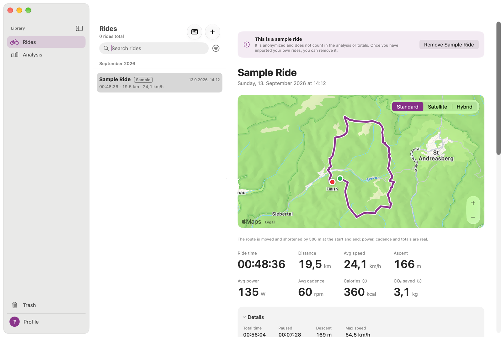

# Wattspur – User Guide

Wattspur is a free Mac app for the rides you record with a Bosch eBike and the eBike Flow app. It reads the FIT files you export from the Flow app, and GPX files from other bikes, apps and bike computers, and shows each ride with a map, key figures and charts. It also adds everything up over weeks, months and years.

- **Local:** your rides stay on your Mac. There is no account, no subscription and no upload.
- **Exact:** the totals (time, distance, speed, power, cadence, ascent) are the values Bosch stores in the file, the same ones the Flow app shows. Totals that Wattspur calculates from a GPX file are marked ≈ (estimated).
- **English and German:** Wattspur follows the language of your Mac.

## Contents
1. [Install Wattspur](01-installation.md): download, open the first time, requirements
2. [First launch](02-first-launch.md): the setup assistant and the sample ride
3. [Importing rides](03-importing.md): export from the Flow app, watched folder, drag and drop, import log
4. [Views](04-views.md): ride list, similar rides and history, saved routes, ride detail, analysis, highlights, map, map styles, trash, settings, keyboard
5. [Metrics](05-metrics.md): where every value comes from and how estimates are calculated
6. [FAQ and troubleshooting](06-faq.md)
7. [Profile and bikes](07-profile-and-bikes.md): body data, several bikes, assigning rides, filters
8. [Importing GPX files](08-importing-gpx.md): rides from other bikes and apps, estimated totals, the same ride as FIT and GPX, filter by source

## Requirements
- A Mac with **macOS 26** or later.
- Rides recorded with a Bosch eBike system and the **Bosch eBike Flow** app on your iPhone.
- For the automatic import: iCloud Drive on iPhone and Mac (optional).
